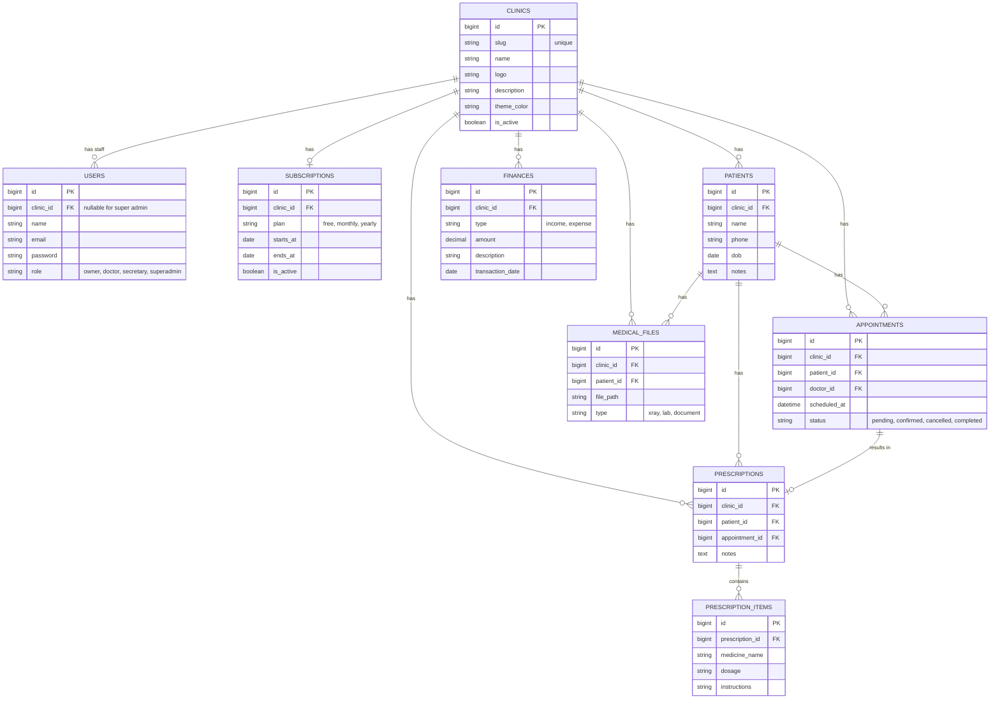

# 🏥 Clinora SaaS Clinic Management System - Architecture & Design

## 1. System Architecture

The application will follow a **Domain-Driven Design (DDD) lite** approach using standard Laravel conventions with strict layer separation:

*   **Controllers (`app/Http/Controllers`)**: Thin orchestrators. They handle HTTP requests, validate input (via FormRequests), call the appropriate Service, and return responses.
*   **Services (`app/Services`)**: The core business logic layer. They orchestrate multiple Repositories, handle external API calls, and enforce business rules (e.g., subscription checks).
*   **Repositories (`app/Repositories`)**: Data access layer. All database queries, Eloquent calls, and data formatting happen here. (Using Interfaces for binding).
*   **Models (`app/Models`)**: Eloquent models representing database entities and relationships. Includes global scopes for multi-tenancy.
*   **DTOs (`app/DTOs`)**: Data Transfer Objects to pass typed data between Controllers and Services when payloads are complex.
*   **Actions (`app/Actions`)**: (Optional) Single-responsibility classes for isolated tasks (e.g., `CreateTenantAction`, `CheckSubscriptionAction`) to keep Services from becoming bloated.

## 2. Multi-Tenant Architecture (`clinic_id`)

We will use a **Single-Database Multi-Tenancy** approach. 

### Implementation:
1.  **Global Scope**: A global scope (`TenantScope`) will be applied to all tenant-specific models (`Patient`, `Appointment`, `Prescription`, etc.) to automatically filter by the current `clinic_id`.
2.  **Trait (`BelongsToClinic`)**: A trait will be added to models to automatically assign the current authenticated user's `clinic_id` on creation and apply the `TenantScope`.
3.  **Middleware (`IdentifyTenant`)**: 
    *   **Dashboard**: Identifies the tenant from the authenticated user's `clinic_id`.
    *   **Landing Page (`/{clinic-slug}`)**: Resolves the `Clinic` model from the slug in the URL and sets it as the current active tenant in the app container.

## 3. Database Design (ERD)



## 4. Laravel Module Breakdown

### Core Modules:
1.  **Tenant / Onboarding Module**: Handles User registration, automated Clinic creation, generating the unique slug, and bootstrapping the Free trial.
2.  **Subscription & Billing Module**: Manages plans (free, monthly, yearly), trial expiration, cron jobs, and subscription middleware gates.
3.  **Booking / Public Facing Module**: The public landing page (`/{slug}`) showcasing clinic info and the dynamic appointment request system.
4.  **Clinical Module**: The core medical system handling Patients, Appointments, Prescriptions, Medical Files, and Notes.
5.  **Financial Module**: Simple income & expense tracking with profit overview.
6.  **Staff & Role Module**: Managing secretaries, additional doctors, and Spatie roles/permissions for granular access control.
7.  **Super Admin Module**: Global overview of all clinics, subscriptions, user management, and system analytics.

## 5. Services + Repositories Implementation Pattern Example

### Repository (`app/Repositories/PatientRepository.php`)
Handles all data fetching.

```php
namespace App\Repositories;

use App\Models\Patient;
use App\Repositories\Interfaces\PatientRepositoryInterface;

class PatientRepository implements PatientRepositoryInterface 
{
    public function create(array $data): Patient 
    {
        // clinic_id is auto-filled by BelongsToClinic trait on the Model
        return Patient::create($data); 
    }
    
    public function getLatest() 
    {
        // Scoped automatically to current clinic via TenantScope
        return Patient::latest()->take(10)->get();
    }
}
```

### Service (`app/Services/PatientService.php`)
Handles business logic.

```php
namespace App\Services;

use App\Repositories\Interfaces\PatientRepositoryInterface;
use App\Exceptions\SubscriptionExpiredException;

class PatientService 
{
    public function __construct(
        protected PatientRepositoryInterface $patientRepo,
        protected SubscriptionService $subscriptionService
    ) {}

    public function registerPatient(array $data) 
    {
        // 1. Enforce business rules
        if (!$this->subscriptionService->hasActiveSubscription()) {
            throw new SubscriptionExpiredException('Your subscription is inactive. Please contact support.');
        }
        
        // 2. Additional logic (e.g., formatting data, sending welcome SMS)
        // ...
        
        // 3. Delegate to Repository
        return $this->patientRepo->create($data);
    }
}
```

### Controller (`app/Http/Controllers/PatientController.php`)
Thin layer for orchestration.

```php
namespace App\Http\Controllers;

use App\Http\Requests\StorePatientRequest;
use App\Services\PatientService;

class PatientController extends Controller 
{
    public function __construct(protected PatientService $patientService) {}

    public function store(StorePatientRequest $request) 
    {
        $patient = $this->patientService->registerPatient($request->validated());
        
        return redirect()->route('patients.show', $patient)
                         ->with('success', 'Patient registered successfully.');
    }
}
```

## 6. Daily Cron Job Requirement & Subscription Lock

**`app/Console/Commands/CheckSubscriptions.php`**
Scheduled in `routes/console.php` (or `app/Console/Kernel.php` for older Laravel) to run `->daily()`.

**Logic in `SubscriptionService@processExpirations`**:
1. Query `Subscription::where('ends_at', '<', now())->where('is_active', true)`.
2. Chunk results and update to `is_active = false`.
3. Dispatch `SubscriptionExpired` event.
4. Listeners send an email notification to the Clinic owner.

**Lockout Middleware (`CheckSubscriptionStatus`)**:
*   Applied to all `web` and `api` routes under the tenant dashboard.
*   If `auth()->user()->clinic->subscription->is_active === false`, the middleware aborts the request and redirects to a dedicated `subscription.expired` view.
*   This view shows: *"Your subscription has expired. Please contact support."* along with a WhatsApp/Contact link.
